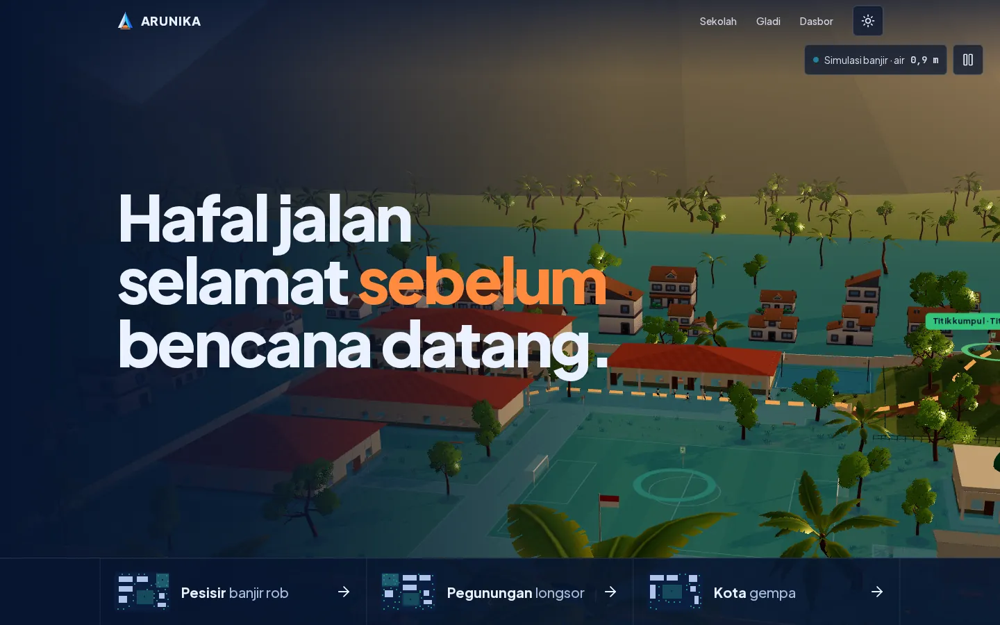
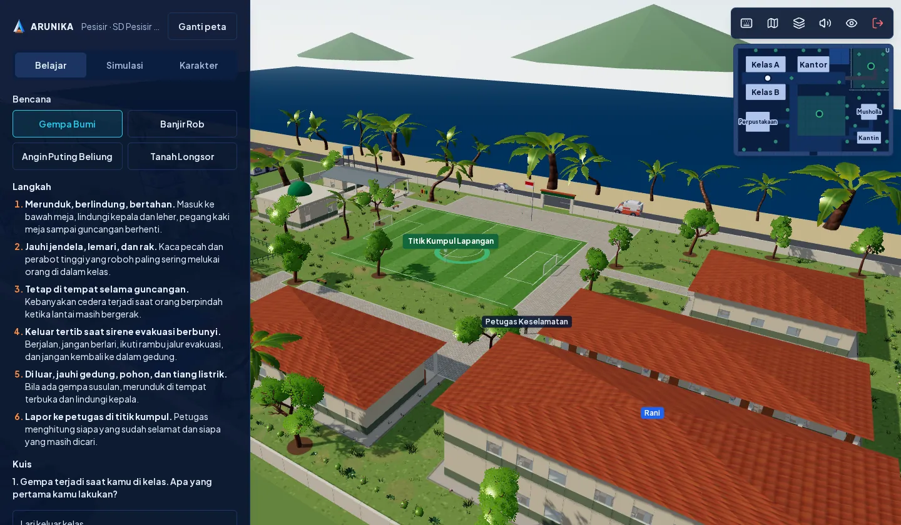
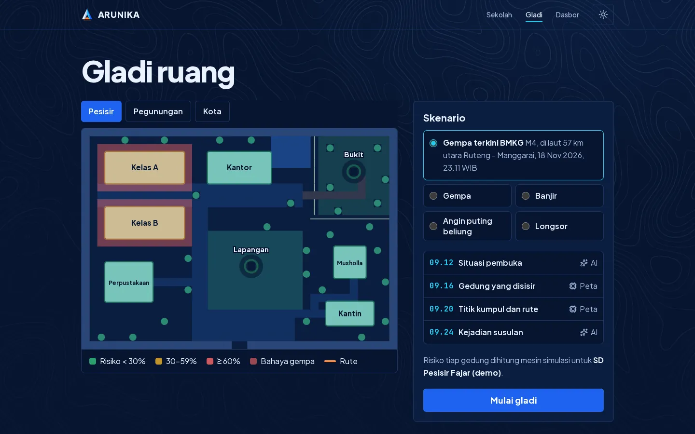
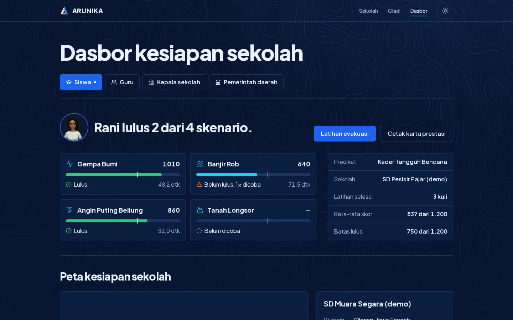
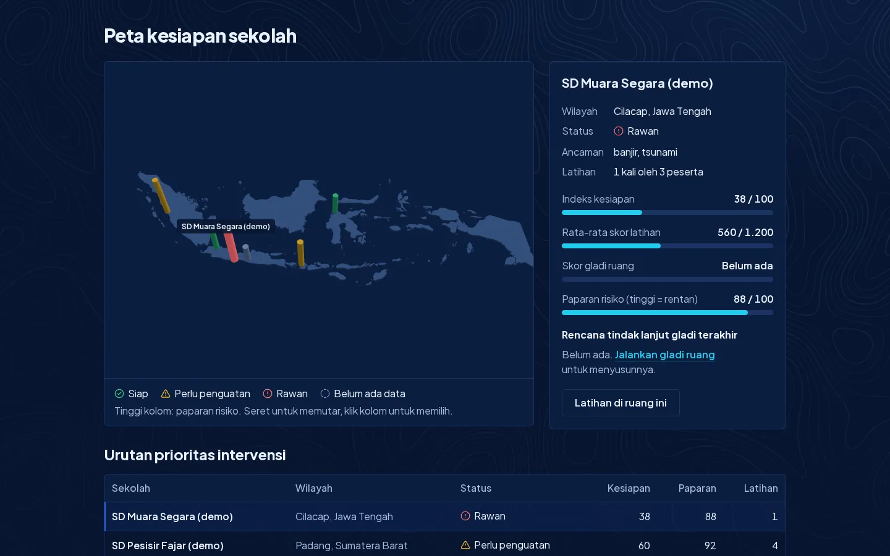
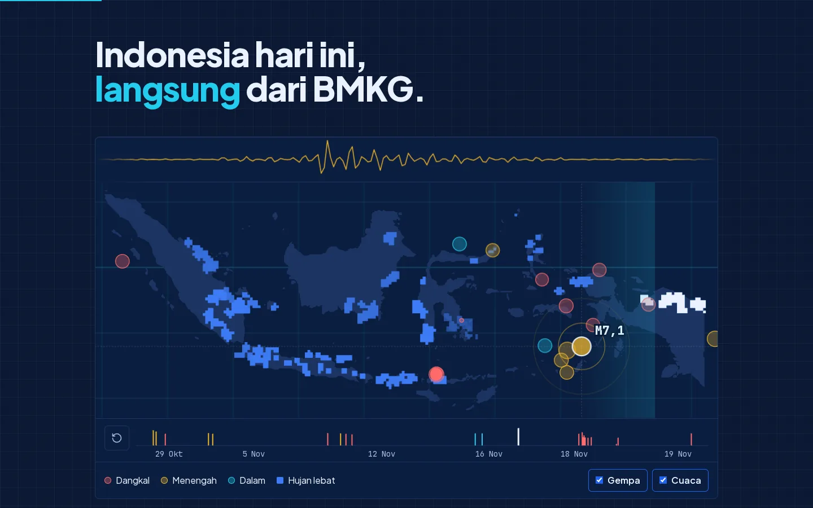
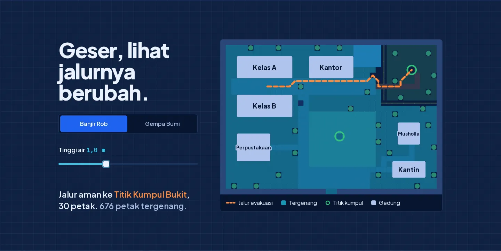
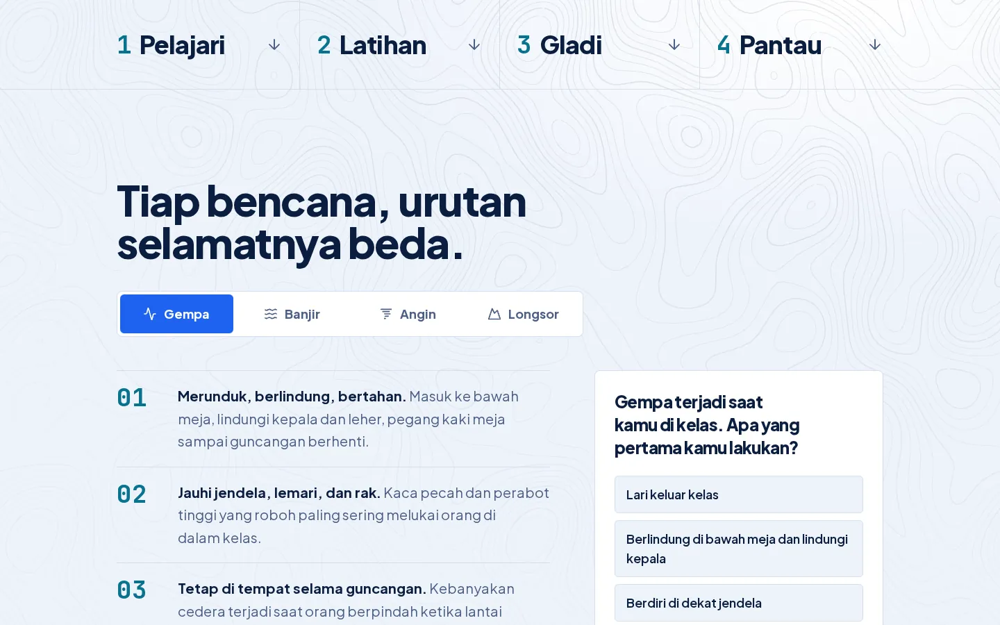
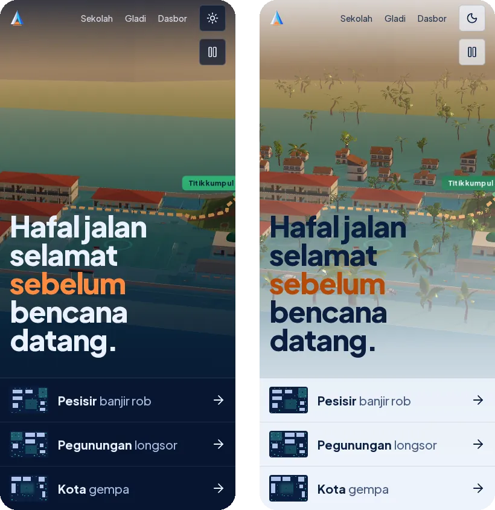

# Arunika

Arunika adalah latihan kesiapsiagaan bencana untuk sekolah di wilayah rawan bencana Indonesia. Siswa berlatih evakuasi bersama di sekolah 3D, tim siaga sekolah menjalankan gladi ruang di atas denah sekolahnya, dan kepala sekolah sampai pemerintah daerah membaca hasilnya di satu dasbor. Urutan tindakan mengikuti panduan Satuan Pendidikan Aman Bencana (SPAB) dari BNPB.

Karya untuk IT RUSH 2026, kategori Web Development, subtema **Mitigasi Bencana dan Perubahan Iklim**.

| | |
| --- | --- |
| Website | https://arunika-gamma.vercel.app |
| Repositori | https://github.com/Ariffansyah/Arunika |
| Akun demo | Tercantum di proposal. Tanpa akun, pilih **Coba sebagai tamu** di halaman Masuk. |



## Latar belakang

Banyak sekolah di Indonesia berdiri di wilayah rawan gempa, banjir, longsor, atau angin puting beliung. Di banyak sekolah, simulasi evakuasi hanya digelar sesekali dan hasilnya tidak tercatat: siswa tidak tahu apakah jalurnya sudah tepat, kepala sekolah tidak punya angka untuk RKAS, dan BPBD tidak tahu sekolah mana yang perlu didatangi lebih dulu.

Arunika menjadikan latihan itu bisa diulang kapan saja, dinilai, dan terkumpul. Setiap latihan menghasilkan data yang sama untuk empat peran: siswa, guru, kepala sekolah, dan pemerintah daerah.

## Fitur

### Latihan evakuasi di sekolah 3D (`/sekolah`)



- **Tiga sekolah, tiga ancaman.** Sekolah pesisir (banjir rob, bukit evakuasi), pegunungan (lereng rawan longsor), dan kota (gedung bertingkat, rawan gempa). Dipilih dari menu peta sebelum masuk, bersama karakter berseragam SMP.
- **Empat skenario.** Gempa bumi (merunduk, berlindung, bertahan), banjir dan rob (air naik, arus, bahaya listrik), angin puting beliung, dan tanah longsor.
- **Belajar sebelum latihan.** Langkah selamat dan kuis per bencana, sama dengan yang diajarkan di beranda.
- **Satu kelas serentak.** Guru membagikan satu tautan ruang. Siswa di ruang yang sama melihat avatar satu sama lain, mendengar sirene yang sama, dan berevakuasi bersama lewat Supabase Realtime (Broadcast dan Presence).
- **Dinilai sampai titik kumpul.** Selesai latihan, jejak langkah siswa dibandingkan dengan rute terbaik dari *pathfinder* A*: jarak, waktu, efisiensi rute, dan catatan evaluasi.
- **Petugas AI.** Asisten keselamatan di dalam latihan, dijawab secara *streaming*. Bisa ditanya lewat suara (Web Speech API) dan menjawab dengan suara.

### Gladi ruang di atas denah sekolah (`/gladi`)



Gladi ruang (*tabletop exercise*) adalah latihan BNPB untuk tim siaga sekolah: bencana dibahas langkah demi langkah di atas peta. Mejanya denah sekolah yang sama dengan latihan 3D, dan yang menghitung bahaya adalah mesin simulasi Arunika, bukan AI.

- **Peta dihitung mesin simulasi.** Risiko runtuh atau rusak tiap gedung (dari material, umur bangunan, jenis tanah, dan jarak ke pantai), petak tergenang atau rawan reruntuhan, dan titik kumpul yang aman. Peta berubah begitu skenario diganti, sebelum AI dipanggil.
- **Skenario dari gempa sungguhan.** Gempa terkini diambil dari umpan publik BMKG (`autogempa.json`). Jarak episentrum ke sekolah dihitung dengan rumus haversine; bila jauh, gempa yang sama dipindahkan ke dekat sekolah. Banjir, longsor, dan angin puting beliung juga bisa dipilih.
- **Empat langkah, dua penilai.**
  1. AI menyusun detik-detik pertama di sebuah kelas. Peserta memilih atau menulis tindakannya, lalu AI menilainya.
  2. Di peta: gedung mana yang dikosongkan lebih dulu. Dinilai mesin dari peringkat risiko.
  3. Di peta: ke mana penghuninya dievakuasi. *Pathfinder* A* menggambar rute, menghitung meter, detik berjalan, dan petak bahaya yang dilewati, lalu membandingkannya dengan rute terbaik.
  4. AI menyusun komplikasi yang lahir dari keputusan di peta (misalnya absen kurang di titik kumpul yang dipilih), lalu menilai tindakan peserta.
- **Rencana tindak lanjut.** AI menyusun perbaikan rencana siaga sekolah, masing-masing dengan prioritas dan kelas biaya, lalu menyimpannya ke dasbor. Skor gladi adalah rata-rata nilai keempat langkah, bukan angka bebas dari model.
- **Tahan manipulasi.** Setiap langkah ditandatangani HMAC di server, sehingga peramban tidak bisa mengubah situasi atau putusan AI. Keputusan di peta dinilai ulang di server dengan aturan yang sama, dan jawaban peserta dikirim ke model sebagai data JSON untuk menahan *prompt injection*.

### Dasbor kesiapan sekolah (`/dashboard`)





| Peran | Isi dasbor |
| --- | --- |
| Siswa | Rapor kelulusan empat skenario, predikat, dan kartu prestasi yang bisa dicetak. |
| Guru | Tautan ruang kelas untuk latihan serentak, hasil latihan tiap siswa, dan ekspor rekap nilai (CSV). |
| Kepala sekolah | Indeks kesiapan gabungan (latihan evakuasi siswa dan gladi ruang tim siaga), rencana tindak lanjut untuk RKAS, dan laporan yang bisa dicetak. |
| Pemerintah daerah | Peta 3D sekolah se-Indonesia, filter status kesiapan, urutan prioritas intervensi (paparan risiko dikali kesenjangan kesiapan), dan ekspor CSV. |

Sekolah bertanda *(demo)* di dasbor adalah data contoh, bukan data lapangan.

### Pantauan BMKG langsung



- **Gempa dan cuaca ekstrem di satu peta.** Beranda memuat 15 gempa M5+ terakhir dan 15 gempa dirasakan terakhir dari BMKG, digabung berdasarkan waktunya, beserta peringatan dini cuaca yang sedang berlaku. Area tiap peringatan diambil dari poligon kecamatan di dokumen CAP BMKG dan digambar sebagai petak 0,2°.
- **Diputar ulang sesuai urutan kejadian.** Saat bagian ini terlihat, gempa muncul satu per satu mengikuti garis waktu yang dipadatkan ke belakang, sehingga hari-hari terakhir mendapat ruang lebih. Gempa yang dipilih menampilkan gelombang seismik di peta, penampang kedalamannya, dan keterangan dirasakan serta potensi tsunami dari BMKG.
- **Terhubung ke pelajaran dan dasbor.** Peringatan yang menyebut banjir atau angin kencang membuka langkah selamat bencana itu di beranda. Di dasbor, tiap sekolah menampilkan gempa terdekat dan peringatan cuaca yang mencakup lokasinya. Pita berjalan di bagian atas beranda menampilkan gempa dan peringatan terbaru.

### Beranda dan tampilan



- **Bisa dicoba tanpa akun.** Beranda memuat langkah selamat dan kuis per bencana, denah yang jalurnya dihitung ulang saat tinggi air atau kekuatan gempa digeser, contoh penilaian jejak evakuasi, contoh jawaban Petugas AI, gladi ruang dari gempa terkini BMKG, dan pratinjau dasbor tiap peran.
- **Mode gelap dan terang.** Tombol di kepala halaman mengganti tema dengan transisi lingkaran yang tumbuh dari tombol itu ke seluruh halaman. Pilihan tersimpan di peramban. Latihan 3D tetap gelap di kedua tema.
- **Ponsel sampai desktop.** Di layar sentuh, latihan 3D dikendalikan dengan joystick di kiri bawah (makin jauh digeser, makin cepat berjalan) dan tombol Aksi, Lari, Merunduk, serta Lompat di kanan bawah. Ketukan pertama membuka layar penuh dan mengunci posisi mendatar bila peramban mengizinkan (Chrome Android); di peramban lain, ponsel yang tegak diminta memutar layar. Semua halaman menyesuaikan lebar layar.
- **Peralihan antarbagian.** Tiap bagian beranda naik saat masuk layar dan mundur perlahan saat ditinggalkan, dengan pita kata yang terus bergeser di antaranya; pita ini makin cepat saat halaman digulir dan berbalik arah saat digulir ke atas.





## Di mana AI bekerja

AI adalah satu bagian dari fitur, bukan seluruh layar. Bahaya, risiko, rute, dan skor dihitung oleh mesin simulasi Arunika (`lib/`). AI menulis dan menilai bagian yang butuh bahasa.

| Fitur | Model (lewat Groq) | Dikerjakan AI | Dikerjakan mesin Arunika |
| --- | --- | --- | --- |
| Petugas AI di latihan 3D | `qwen/qwen3.8-27b`, *streaming* | Menjawab pertanyaan evakuasi, P3K, dan tas siaga, lewat teks atau suara. | Memberi tahu Petugas AI gedung tempat siswa berdiri dan titik kumpul yang aman untuk skenario itu. Hanya id dan label dari peta yang diteruskan, tidak pernah teks bebas. |
| Gladi ruang | `openai/gpt-oss-120b`, *structured output* | Menulis situasi pembuka dan komplikasi, menilai jawaban bebas peserta, menyusun rencana tindak lanjut. | Risiko tiap gedung, petak bahaya, titik kumpul aman, rute A*, penilaian dua keputusan di peta, dan skor akhir. |

Kedua rute AI (`/api/warden`, `/api/gladi`) hanya melayani pengguna yang masuk, dan dibatasi per pengguna serta per alamat IP. Alamat IP hanya disimpan sebagai *hash* bergaram.

## Teknologi

| Bagian | Yang dipakai |
| --- | --- |
| Kerangka web | Next.js 16 (App Router, Turbopack), React 19, TypeScript |
| 3D | Three.js, React Three Fiber, Drei |
| Tampilan | Tailwind CSS 4, Lucide (ikon), Plus Jakarta Sans dan JetBrains Mono |
| Data dan akun | Supabase: PostgreSQL dengan Row Level Security, Auth (termasuk masuk sebagai tamu), Realtime Broadcast dan Presence |
| AI | Groq SDK dengan `openai/gpt-oss-120b` dan `qwen/qwen3.8-27b` |
| Data publik | BMKG `autogempa.json`, `gempaterkini.json`, `gempadirasakan.json` (di-*cache* satu menit) dan peringatan dini cuaca (RSS nowcast dan dokumen CAP, di-*cache* sepuluh menit), dengan `"use cache"` Next.js |
| Pengujian | Node.js test runner bawaan |
| Hosting | Vercel |

## Menjalankan secara lokal

Butuh Node.js 20.9 atau lebih baru, pnpm, proyek Supabase, dan kunci API Groq.

```bash
git clone https://github.com/Ariffansyah/Arunika.git
cd Arunika
pnpm install
cp .env.example .env.local
```

Isi `.env.local`:

```env
NEXT_PUBLIC_SUPABASE_URL=https://<proyek>.supabase.co
NEXT_PUBLIC_SUPABASE_PUBLISHABLE_KEY=sb_publishable_...
SUPABASE_SECRET_KEY=sb_secret_...
GROQ_API_KEY=gsk_...
```

`SUPABASE_SECRET_KEY` dan `GROQ_API_KEY` hanya dibaca di server; jangan beri awalan `NEXT_PUBLIC_`.

Siapkan basis data:

1. Jalankan `supabase/schema.sql` di SQL Editor Supabase. Skrip ini membuat tabel, *view* kesiapan sekolah, fungsi pembatas permintaan, dan sekolah contoh.
2. Agar tombol **Coba sebagai tamu** berfungsi, aktifkan *Anonymous Sign-ins* di Authentication, Sign In / Providers.

Lalu jalankan:

```bash
pnpm dev
```

Buka http://localhost:3000.

## Pengujian

Pengujian mencakup denah gedung, *pathfinding* dan navigasi, rintangan, model risiko, gladi ruang, dan Petugas AI, di ketiga peta sekolah.

```bash
pnpm test                         # semua peta
node scripts/test.mjs pesisir     # satu peta: pesisir, pegunungan, atau kota
pnpm lint
```

## Struktur direktori

```text
app/
  api/gladi, api/warden   rute AI di server
  sekolah/                latihan evakuasi 3D
  gladi/                  gladi ruang
  dashboard/              dasbor per peran
  masuk/                  masuk, daftar, dan profil
components/
  campus/                 mesin dan HUD latihan 3D
  dashboard/              tampilan tiap peran dan peta 3D Indonesia
  landing/                bagian-bagian beranda
lib/                      logika murni: denah, navigasi, simulasi, risiko, gladi, Petugas AI
public/                   model 3D, karakter, suara, data peta
scripts/                  runner pengujian
supabase/                 skema basis data dan data contoh
docs/screenshots/         gambar untuk README ini
```

## Penggunaan template, pustaka, aset, dan AI

Daftar ini memenuhi ketentuan IT RUSH 2026 bagian V poin 5.

**Template**

- Proyek dimulai dari Create Next App (`create-next-app`). Kerangka bawaannya sudah diganti seluruhnya.

**Pustaka**

- Next.js, React, React DOM (MIT)
- Three.js, `@react-three/fiber`, `@react-three/drei` (MIT)
- `@supabase/supabase-js` (MIT)
- `groq-sdk` (Apache-2.0)
- `lucide-react` (ISC)
- `server-only` (MIT)
- Tailwind CSS, TypeScript, ESLint dan `eslint-config-next` (alat pengembangan)

**Aset terbuka**

- Karakter: "Ultimate Modular Men Pack" dan "Ultimate Modular Women Pack" oleh Quaternius, lewat poly.pizza, dipadukan dan diwarnai ulang menjadi seragam SMP. Gerakan merunduk, duduk, berlindung, berjalan merunduk, dan melompat dipindahkan dari "Universal Animation Library" oleh Quaternius. CC0.
- Tumbuhan: "Ultimate Stylized Nature Pack" oleh Quaternius, lewat poly.pizza. CC0.
- Model 3D: Car Kit, Furniture Kit, Nature Kit, City Kit Suburban, dan Survival Kit oleh Kenney. CC0.
- Suara: "Impact Sounds", "RPG Audio", dan "Interface Sounds" oleh Kenney. CC0. Sirene, gemuruh, hujan, angin, ombak, dan air banjir disintesis di peramban (`components/campus/sound.ts`).
- Fon: Plus Jakarta Sans dan JetBrains Mono dari Google Fonts (SIL Open Font License).
- Model 3D dan karakter dikompresi dengan glTF Transform (MIT), memakai meshopt dan tekstur WebP.
- Rincian lisensi tiap aset ada di `LICENSE.txt` pada folder `public/characters`, `public/sounds`, dan `public/models/*`.

**Data dan pedoman**

- Gempa terkini, gempa M5+, dan gempa dirasakan dari umpan publik BMKG (`https://data.bmkg.go.id/DataMKG/TEWS/autogempa.json`, `gempaterkini.json`, `gempadirasakan.json`).
- Peringatan dini cuaca BMKG (`https://www.bmkg.go.id/alerts/nowcast/id/rss.xml` dan dokumen CAP tiap peringatan).
- Urutan tindakan evakuasi mengikuti panduan Satuan Pendidikan Aman Bencana (SPAB) BNPB.
- Garis pantai Indonesia untuk peta 3D dasbor: `public/data/indonesia.json`.

**Model AI di dalam fitur**

- `openai/gpt-oss-120b` dan `qwen/qwen3.8-27b`, keduanya model *open-weight* yang dijalankan lewat API Groq.

**Asisten AI untuk menulis kode**

- Claude Code (Anthropic) dipakai selama pengembangan untuk menulis dan meninjau kode, merancang tampilan, membuat skrip konversi aset, dan menulis dokumentasi. Ide, arah fitur, pengujian di peramban, dan keputusan akhir ada pada tim.

## Lisensi

Hak cipta 2026 Tim Arunika. Aset pihak ketiga mengikuti lisensinya masing-masing seperti tercantum di atas.
